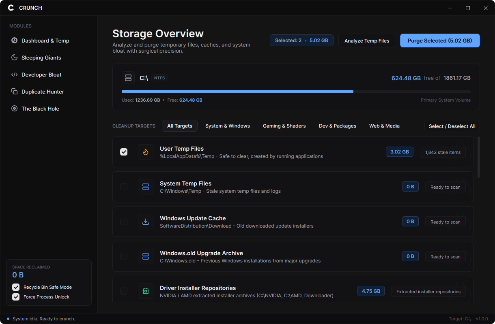
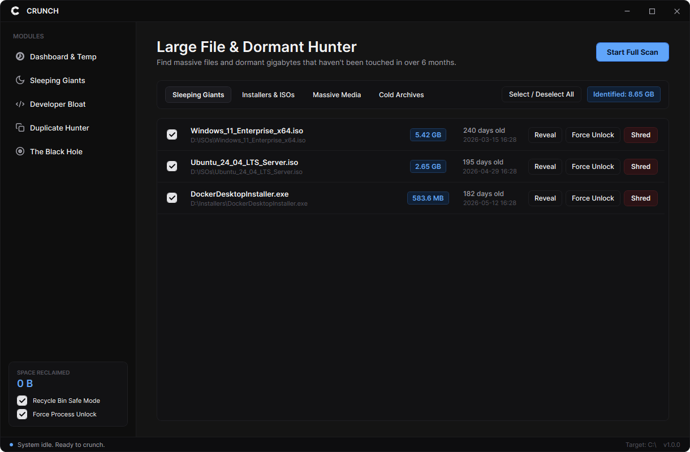
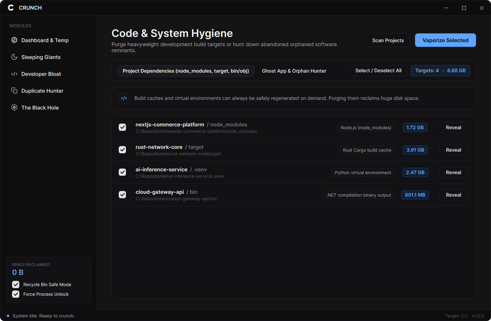
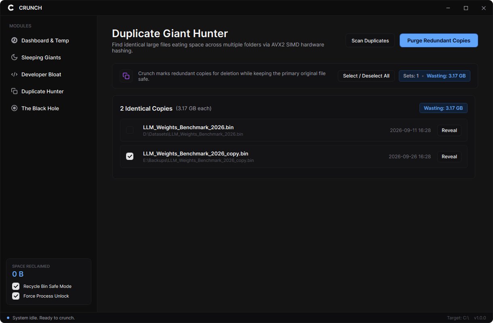

<div align="center">
  
  <h1>Crunch</h1>
  <p><strong>A fast, lightweight disk cleaner and storage analyzer for Windows.</strong></p>

  <p>
    <a href="https://github.com/joaoswu/Crunch/releases/latest"></a>
    
    
    
    
  </p>
</div>

---

## Overview

**Crunch** is a dark-themed disk cleanup and storage analyzer utility for Windows 10 and 11. It helps identify and clean up stale temporary files, large dormant downloads and ISOs, abandoned developer build artifacts (`node_modules`, `target`, `.venv`), and duplicate files.

Crunch runs as a portable standalone executable without requiring an installer or pre-installed runtimes.

<div align="center">
  
</div>

---

## Features

### Storage Overview & Quick Clean
- **Drive Meter:** Displays partition usage and free space calculations.
- **Cache Targets:** Cleans user temp files, Windows Update download cache, crash dumps, and browser/app caches (Chrome, Edge, Discord) without clearing login cookies or session data.
- **Safe Selection:** Items are not selected by default. A live counter displays the exact size of selected items before deletion.

### Large & Dormant Files
- Flags files over 100 MB that have not been modified or accessed recently.
- Categorizes files by type: ISO disk images, installers, video recordings, and archives.
- Includes quick actions to reveal items in File Explorer or delete them directly.

<div align="center">
  
</div>

### Developer Dependencies & Leftover App Data
- **Project Bloat:** Scans user directories for build output and package directories, including `node_modules` (npm), `target` (Rust/Cargo), `.venv` (Python), and `bin`/`obj` (.NET).
- **Orphan Folders:** Identifies folders in `AppData` and `ProgramData` from uninstalled applications by cross-referencing entries against registered Windows uninstall keys.

<div align="center">
  
</div>

### Duplicate File Finder
- Finds identical files across scanned directories.
- Uses a multi-stage comparison: exact file size -> 64KB head/tail hash check -> full `XxHash64` verification.
- Keeps the original file unselected and lets you mark redundant copies for removal.

<div align="center">
  
</div>

### Force Delete ("The Black Hole")
- Drag-and-drop zone for files or folders that fail standard deletion due to active process locks.
- Integrates with the Windows Restart Manager API (`rstrtmgr.dll`) to identify locking processes, close handles, and remove the item.

---

## Technical Details

- **Parallel Directory Traversal:** Multi-threaded worker queue to scan directory trees efficiently on SSDs.
- **Low-overhead Enumeration:** Uses .NET `FileSystemEnumerable<T>` to inspect file sizes during traversal before allocating model instances.
- **XxHash64 Hashing:** Fast non-cryptographic hashing via `System.IO.Hashing` for duplicate comparison.
- **Portable:** Published as a self-contained ReadyToRun single-file executable for 64-bit Windows.

---

## Download

Get the standalone executable from the [Releases](https://github.com/joaoswu/Crunch/releases/latest) page:

1. Download **`Crunch-v1.0.0-win-x64.zip`** (or standalone `Crunch.exe`).
2. Extract and run `Crunch.exe`. No installation required.

---

## Building from Source

### Prerequisites
- [.NET 9.0 SDK](https://dotnet.microsoft.com/download/dotnet/9.0)
- Windows 10 (1809+) or Windows 11 (64-bit)

### Build
```bash
git clone https://github.com/joaoswu/Crunch.git
cd crunch

# Run locally in development
dotnet run

# Publish self-contained single-file executable
dotnet publish -c Release -r win-x64 --self-contained true -p:PublishSingleFile=true -p:IncludeNativeLibrariesForSelfExtract=true -p:EnableCompressionInSingleFile=true -o ./dist
```

---

## License

This project is licensed under the [MIT License](LICENSE).
